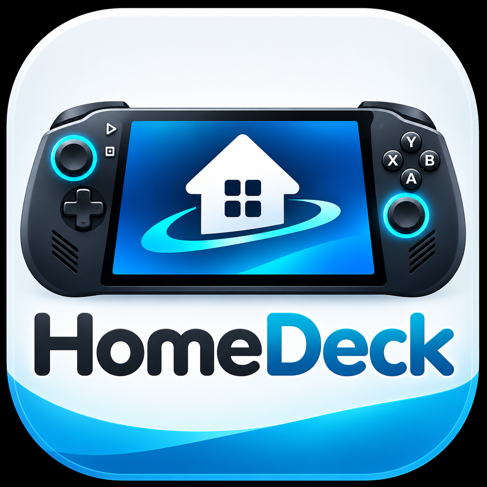

# homedeck



<a href="https://www.buymeacoffee.com/spladlesrus" target="_blank"></a>

## License

homedeck is source-available under the [Horton Press Personal Use License 1.0.0](LICENSE), adapted from the PolyForm Strict License 1.0.0. It is not an open source license.

- Free for personal, non-commercial use.
- You may not fork, redistribute, modify for distribution, sublicense, or use homedeck commercially without written permission from Horton Press.
- Provided with no warranty and with a limitation of liability.

Copyright (c) 2026 Horton Press. For permission requests, contact support@hortonpress.com.

## What is HomeDeck?

HomeDeck is a console-style app launcher. Milestone 1 targets Windows: a
WiiSU-style paged Home with a now-playing widget, platform-folder Library,
keyboard / mouse / XInput navigation, manual add of `.exe` / `.lnk` files,
launch with clear errors, and a layout that is remembered after restart.

Branding is original. There are no Nintendo logos, names, or artwork.

Architecture and how to add other platform adapters later:
[docs/ARCHITECTURE.md](docs/ARCHITECTURE.md).

Open questions, icon limits, and Windows run instructions:
[docs/DECISIONS.md](docs/DECISIONS.md).

## Run on Windows

```bat
flutter pub get
flutter run -d windows
```

`F11` toggles fullscreen. Launching a game enters the same fullscreen chrome
by default (Settings → **Fullscreen on launch**; turn off to stay windowed).
Settings (Ctrl+,) also exposes borderless chrome, menu-music on/off plus
volume, and UI clicks. Ten instrumental tracks start at a random song and
loop as a playlist; music ducks while a launched game has focus. Press Y for
global search. B is always Back.

Add a **Native** tile (`.exe`, `.lnk`, or a store URI such as
`steam://rungameid/440`) or an **Emulated** tile (emulator + ROM + `{rom}`
arguments). New games go to the **Library**; optionally pin them to **Home**.
Settings → **Scan Steam library** (or keyboard **S**) imports installed Steam
games as `steam://rungameid/…` tiles. Settings → **Scan Start Menu** (or
keyboard **P**) imports Start Menu Programs shortcuts (resolved `.exe` /
URI / `.lnk`). Settings → **Choose ROM folder** / **Scan ROM folder** (or
keyboard **R**) imports common ROM files as emulated tiles with `{rom}` args
(`HOMEDECK_ROM_ROOT` / `HOMEDECK_EMULATOR` optional for Ally fixtures).
Settings → **Scan Epic Games** (or keyboard **E**) imports Epic Games
Launcher titles as `com.epicgames.launcher://apps/…` tiles when available
(else resolved `.exe`; optional `HOMEDECK_EPIC_ROOT` fixture). Settings →
**Scan GOG** (or keyboard **G**) imports GOG Galaxy titles as
`goggalaxy://openGameView/…` tiles when available (else resolved `.exe`
from `goggame-*.info`; optional `HOMEDECK_GOG_ROOT` fixture). Settings →
**Scan Ubisoft Connect** (or keyboard **U**) imports Ubisoft Connect titles
as `uplay://launch/…` tiles when available (else resolved `.exe`; optional
`HOMEDECK_UBISOFT_ROOT` fixture with `ubisoftgame-*.info`). Settings →
**Scan EA App** (or keyboard **O**) imports EA App / Origin titles as
`origin://launchgame/…` tiles when available (else resolved `.exe`;
optional `HOMEDECK_EA_ROOT` fixture with `__Installer\installerdata.xml`).
Focus a Library tile and press **H** to pin it to Home (same as Menu → Add
to Home; for Ally harnesses that cannot reach that control). **Delete** /
**Backspace** unpins a focused Home tile, or asks to remove a focused
Library tile (Enter confirms; Esc cancels — same as Menu Remove, without
UIA).

Release defaults to an empty library. To preview a full grid in debug only:

```bat
flutter run -d windows --dart-define=HOMEDECK_SEED_DEMO=true
```

Do not pass that define on a release build.

## UI screenshots

Rendered at 1280×800:

- [Before (empty dark home)](docs/proof/ui/before-1280x800.png)
- [After (Home page 1, featured now-playing)](docs/proof/ui/01-home-page1-featured.png)
- [Home page 2 with empty slots and peeks](docs/proof/ui/02-home-page2-empty-peeks.png)
- [Library platform root (dock on Library)](docs/proof/ui/03-library-folders.png)
- [Inside a Library platform](docs/proof/ui/04-folder-hero.png)
- [Global search](docs/proof/ui/08-global-search.png)

## Open questions

- Should the library be limited to games and emulators, or include general apps?
- Games-only filter for Steam tools/redistributables vs keep everything Steam lists?
